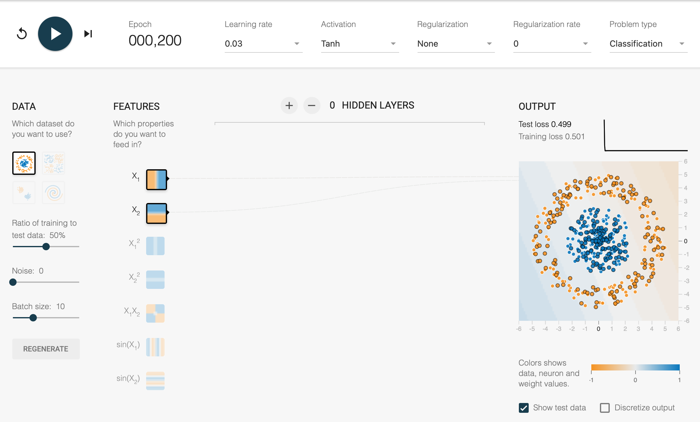
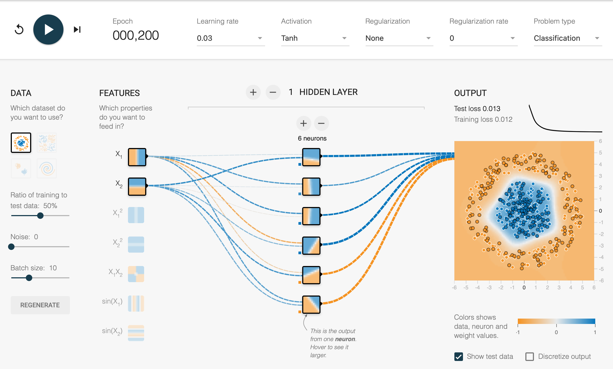
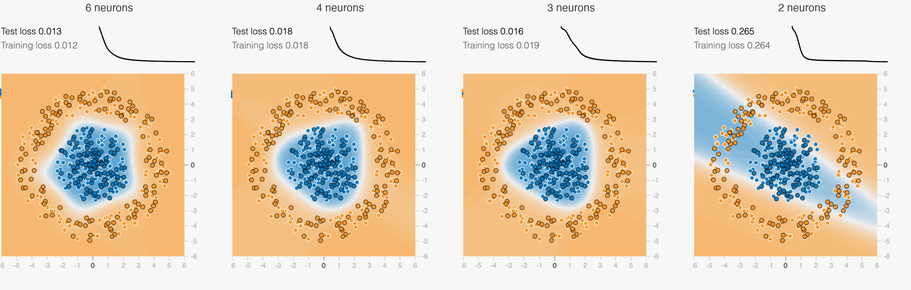
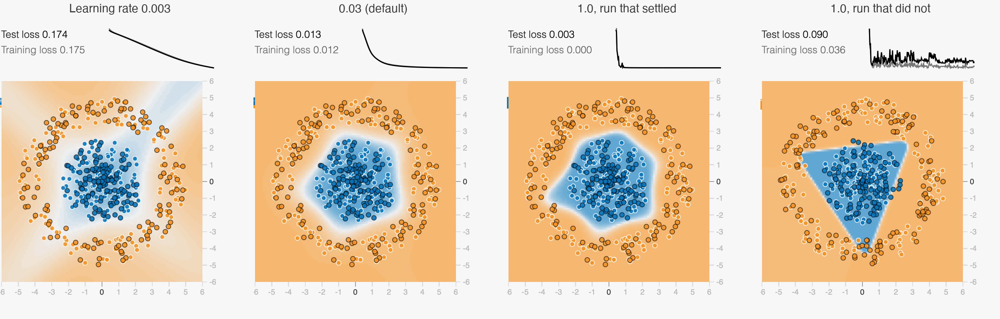
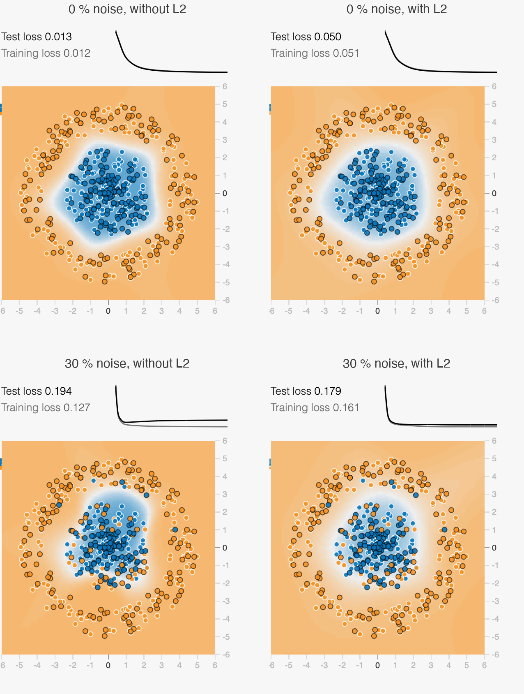
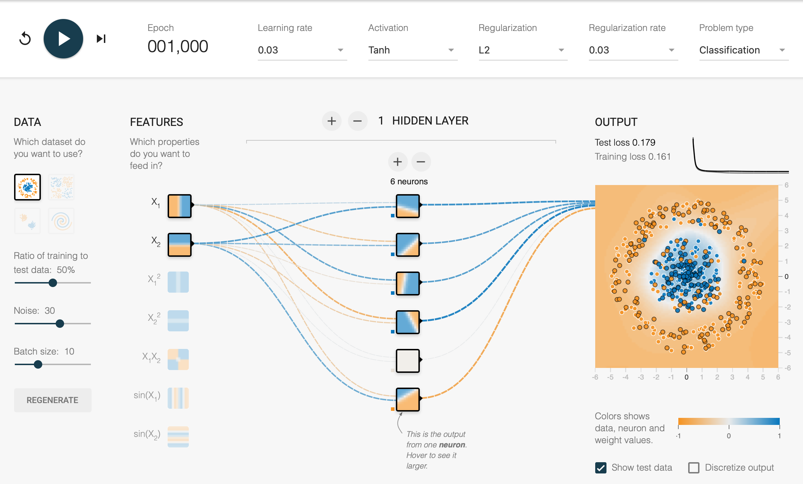

# Part 1 – TensorFlow Playground

**Setup.** All runs use the TensorFlow Playground with:

- Problem type = Classification and the Circle data set: 500 points, a blue disk in the centre surrounded by an orange ring.
- A 50 % ratio of training to test data (250 points each), with Show test data on. Test points have a black outline, training points a white one.
- Only the features x1 and x2, batch size 10 and the Tanh activation.
- Unless stated otherwise, a learning rate of 0.03 and no regularization.

**What the numbers mean.** The Playground reports the training loss and the test loss, not the accuracy. The loss is the average of ½ · (output − label)², where the label is −1 (orange) or +1 (blue) and the output lies between −1 and +1. A loss of 0 means every point is classified correctly and with full confidence. A loss of 0.5 is what a model gets if its output is 0 everywhere, i.e. if it cannot decide.

**Making runs comparable.** The Playground stores all settings, including the random seed, in its URL. We fixed the seed (0.42000) so that every run starts with the same data and the same initial weights. We used the step button to stop every run at exactly the stated epoch (200, and 1,000 for the longer runs), so the numbers in the text match the screenshots. We repeated the key comparisons with two further seeds (0.11111 and 0.77777). We also set the noise through the URL, because moving the noise slider by hand creates a new random data set.

## A1 – Linear model on the ring

**Setting:** 0 hidden layers, learning rate 0.03, no regularization (Figure A1).

**What we see.** The decision boundary is a straight line that runs diagonally through the middle of the plot. The background is pale blue on one side and pale orange on the other, so the model is unsure everywhere. Both sides contain blue and orange points: roughly 40 % of the points lie on the wrong side. The lines from x1 and x2 to the output are almost invisible, which means the weights are close to 0. The loss drops from 0.53 to 0.50 within the first ten epochs and then stays there (training loss 0.501 and test loss 0.499 after 200 epochs). Training longer does not help.

**Why the ring cannot be separated.** Without a hidden layer, the network computes output = tanh(w1 · x1 + w2 · x2 + b), and the points where the output is 0 form a straight line: the model is linear. The two classes are not linearly separable, because the blue points form a disk and the orange points a ring around it. Every straight line cuts through the ring and leaves blue and orange points on both sides. No line can enclose the disk.

The best the model can do is to hedge. It keeps its weights small, so its output stays close to 0 everywhere (the pale colours and the faint lines). This gives the loss of 0.5 of an undecided model. Both losses stay flat and high, which the lecture describes as underfitting: the model has too little capacity for the shape of the data. More training does not fix this; a more flexible model does.

**Figure A1 – No hidden layer, learning rate 0.03, after 200 epochs.** The pale, almost uniform background shows a straight boundary with low confidence on both sides. Both losses stay at 0.50, as the flat loss curve at the top right shows.

## A2 – Hidden layer and model capacity

**Setting:** 1 hidden layer with 6 neurons, Tanh, learning rate 0.03, no regularization.

**How the boundary changes.** The boundary is no longer a line. It is a closed, roughly round curve that encloses the blue disk and runs through the empty gap between the disk and the ring (Figure A2). The test loss falls quickly: 0.31 after 10 epochs, 0.06 after 50, 0.024 after 100 and 0.013 after 200 epochs (training loss 0.012). Every training and test point lies on the correct side.

**Fewer neurons.** Each run below lasted 200 epochs with the same seed (Figure A2b):

| Neurons in the hidden layer | Shape of the boundary | Training loss | Test loss |
|---|---|---|---|
| 6 | closed, almost round polygon | 0.012 | 0.013 |
| 4 | closed, rounded four-sided shape | 0.018 | 0.018 |
| 3 (extra test) | closed, rounded triangle | 0.019 | 0.016 |
| 2 | open diagonal band | 0.264 | 0.265 |

With 4 neurons the ring is still separated cleanly. With 2 neurons it is not. The boundary becomes a band across the whole plot, which contains the blue disk but also two parts of the orange ring, and about one in five points ends up on the wrong side. Of 6, 4 and 2, the smallest count that still separates the ring well is therefore 4. An extra test showed that 3 neurons also work. The result held with two further seeds: 3 neurons reached a test loss of 0.022 and 0.025, while 2 neurons failed again with a test loss of 0.32.

**What this reveals about capacity.** Every hidden neuron receives only x1 and x2, so on its own it can only draw one soft straight edge. The Playground shows this directly: the small picture of each hidden neuron in Figure A2 is split by a single line. The output neuron combines these edges:

- To enclose a region in a plane, at least three edges are needed (a triangle).
- With two edges, only a band or a wedge is possible, and both are open to the outside.
- More neurons give more edges and therefore a rounder curve: 3 neurons give a rounded triangle, 4 a rounded four-sided shape, 6 an almost round polygon. Beyond the minimum, they make the boundary smoother rather than the separation better.

Capacity is the range of shapes a model can represent: no hidden neuron only lines (A1), 2 neurons only bands, 3 or more neurons closed shapes. The model needs enough capacity for the shape of the data, here a closed curve.

**Figure A2 – Best decision boundary (1 hidden layer, 6 neurons, Tanh, learning rate 0.03, after 200 epochs).** These visual aspects show its quality:

- **Clean separation:** the boundary is a closed curve with every blue point inside and every orange point outside, for the training points and for the test points (black outline).
- **Placement:** it runs through the middle of the empty gap between the two classes, so small shifts of a point would not change its class.
- **Smooth shape:** it is smooth and roughly round, like the data itself, without bumps around single points.
- **Confidence:** the colours are strong on both sides and fade only in a narrow band inside the gap, so the network is confident wherever there are points.
- **Generalisation and convergence:** the test loss (0.013) is as low as the training loss (0.012), and the loss curve at the top right has flattened.

**Figure A2b – Output after 200 epochs with 6, 4, 3 and 2 neurons in the hidden layer.** With 3 or more neurons the boundary is closed. With 2 neurons it is an open band that also covers parts of the orange ring.

## B1 – Learning rate 0.003 vs 1.0

**Setting:** the architecture from A2 (1 hidden layer, 6 neurons, Tanh), no noise, no regularization. The default 0.03 is shown for reference.

| Learning rate | Test loss after 10 epochs | after 50 | after 200 | Course of the loss |
|---|---|---|---|---|
| 0.003 | 0.480 | 0.405 | 0.174 | smooth, falls steadily |
| 0.03 (A2) | 0.305 | 0.057 | 0.013 | smooth |
| 1.0 | 0.014 | 0.003 | 0.003 | jumps up and down at the start |

**Speed.** With 0.003 the steps are ten times smaller than with 0.03, and training is about ten times slower. After 200 epochs the test loss is still 0.17 and the boundary is only a pale outline, with about 5 % of the points still on the wrong side (Figure B1, left). It takes about 1,000 epochs to reach the test loss that 0.03 reaches after 100 epochs (0.024). With 1.0 the test loss fell below 0.03 within 20 epochs in two of our three runs.

**Stability.** With 0.003 the loss falls steadily: it did not jump up a single time in 1,000 epochs, and the boundary grows gradually. With 1.0 the steps are so large that the weights overshoot. The loss curve is jagged, and the boundary visibly jumps from epoch to epoch:

- In two of our three runs (different seeds), it calmed down after 20 to 40 epochs.
- In the third run it never settled. Between epochs 100 and 200 the test loss still jumped between 0.06 and 0.20. After 1,000 epochs the training loss was 0.024 but the test loss 0.088.
- This run was not even reproducible. With the same settings and seed, a second browser showed a test loss of 0.14 instead of 0.090 after 200 epochs, while every stable setting gave identical numbers in both browsers. With such large steps, tiny rounding differences grow into visibly different results.

**Final boundary quality.**

- **0.003:** given enough epochs, it ends with a smooth, round boundary, like 0.03.
- **1.0:** it ends with a very sharp boundary: hard colour edges, a narrow transition and a more angular shape. The large steps drive the weights to large values and push the Tanh neurons into saturation.
  - When the run settles, the loss is very low (0.003), but the shape depends on luck.
  - In the run that did not settle, the region is a hard-edged triangle whose lower tip reaches into the orange ring (Figure B1, right).

**Conclusion.** A small learning rate is safe but slow, and a very large one is fast but unreliable. Here the default of 0.03 is the best compromise: fast and stable.

**Figure B1 – Output after 200 epochs with learning rates 0.003, 0.03 and 1.0 (two runs with different seeds).** The small chart above each plot shows the test loss (black) and the training loss (grey) over time. With 0.003 the boundary is still pale and the loss is still falling. With 1.0 the boundary has hard edges, and in the run that did not settle the loss curve is jagged.

## B2 – L2 regularization under 30 % noise

**Setting:** the architecture from A2, learning rate 0.03, L2 regularization with rate 0.03, noise first 0 %, then 30 %. For comparison we ran exactly the same settings without regularization. The same seed means the same data and the same starting weights.

| Noise | Regularization | Training loss | Test loss | Epochs |
|---|---|---|---|---|
| 0 % | none | 0.012 | 0.013 | 200 |
| 0 % | L2, 0.03 | 0.051 | 0.050 | 200 |
| 30 % | none | 0.138 → 0.127 | 0.178 → 0.194 | 200 → 1,000 |
| 30 % | L2, 0.03 | 0.174 → 0.161 | 0.183 → 0.179 | 200 → 1,000 |

**Is the boundary smoother with L2?** Yes. Even without noise, the boundary with L2 is rounder and softer: the colours fade over a wider band (Figure B2a, top). L2 keeps the weights small: the lines in the network diagram, whose thickness shows the size of each weight, are visibly thinner. Small weights mean gentle Tanh curves instead of sharp steps. The price, without noise, is a higher loss (test loss 0.050 instead of 0.013): the outputs are less extreme, although every point is still classified correctly.

**How test performance changes with 30 % noise.** With noise, some points carry the colour of the other class for their position. No boundary can classify everything correctly, and both losses rise to about 0.18. Both settings classify about 88 % of the test points correctly. After 200 epochs they are almost equal (test loss 0.178 without and 0.183 with L2). The difference appears with longer training:

- **Without L2:** the training loss keeps falling (0.138 → 0.127 at epoch 1,000), while the test loss rises (0.178 → 0.194). The weights keep growing, and the boundary loses its round shape: it gets a dent and a bulge where it bends towards individual noisy points (Figure B2a, bottom left). The lecture describes exactly this pattern: training loss falling while validation loss rises means overfitting.
- **With L2:** both losses stay flat (test loss 0.183 → 0.179), and the gap between training and test loss stays small (0.018 instead of 0.067 after 1,000 epochs). The weights stay about half as large, and the boundary stays smooth, symmetric and roughly round (Figure B2a, bottom right). L2 has even switched one of the six hidden neurons off: in Figure B2b its picture is empty and its lines are almost invisible.

**Which setting is more robust, and why?** L2 on. Its result hardly depends on how long we train or on individual noisy points, and its training loss is an honest estimate of its test loss. We repeated the comparison with two further seeds:

- In all three runs, L2 kept the gap between training and test loss smaller (0.008–0.075, against 0.053–0.094 without L2 after 1,000 epochs).
- With L2, the test loss never rose with longer training. Without L2, it rose in two of the three runs.
- The gain in test loss itself was small: after 200 epochs, the model without L2 was even slightly ahead in all three runs (by 0.005–0.014). With only 6 neurons the model has little capacity to memorise noise, so here L2 mainly stops the slow drift towards overfitting. With a larger network we would expect a bigger benefit.

The reason is how L2 works. It adds the sum of the squared weights, multiplied by the rate, to the loss, so every weight is pulled towards 0 unless it clearly helps many points. Bending the boundary around a single noisy point would need large weights for a sharp local curve, and the penalty makes that expensive. The boundary therefore follows the overall shape of the data, a circle, and ignores single outliers.

**Figure B2a – Output without L2 (left) and with L2 regularization (right): at 0 % noise after 200 epochs (top) and at 30 % noise after 1,000 epochs (bottom).** With L2 the boundary is rounder and its edges are softer. At 30 % noise without L2, the boundary has a dent and a bulge, and the loss chart shows the test loss (black) slowly rising above the falling training loss (grey). With L2 both curves stay flat and close together.

**Figure B2b – Setup and result: L2 regularization with rate 0.03 at 30 % noise, after 1,000 epochs.** Test loss 0.179, training loss 0.161. The fifth hidden neuron has been switched off by the regularization.

## Summary and link to Part 2

- **Capacity:** a linear model cannot separate the ring (A1). A hidden layer with a nonlinear activation can, but it needs at least three neurons to enclose a region (A2).
- **Learning rate:** too small is slow but steady, too large is fast but unstable (B1).
- **L2 regularization:** smaller weights give a smoother boundary and, under noise, a stable test loss and a small gap between training and test loss (B2).

The hidden layer in A2 plays the same role as the frozen ResNet-18 in Part 2. It turns the raw input into features in which the classes become linearly separable, so the output neuron only has to draw a straight line in that feature space. In Part 2 the pretrained features are already good enough for one linear layer to reach about 98.5 % accuracy; in the Playground, the network has to learn its features itself.

## References

- Smilkov, D., & Carter, S. *A Neural Network Playground*. https://playground.tensorflow.org
