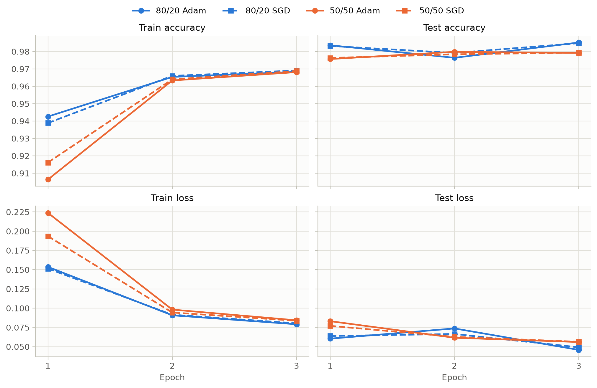
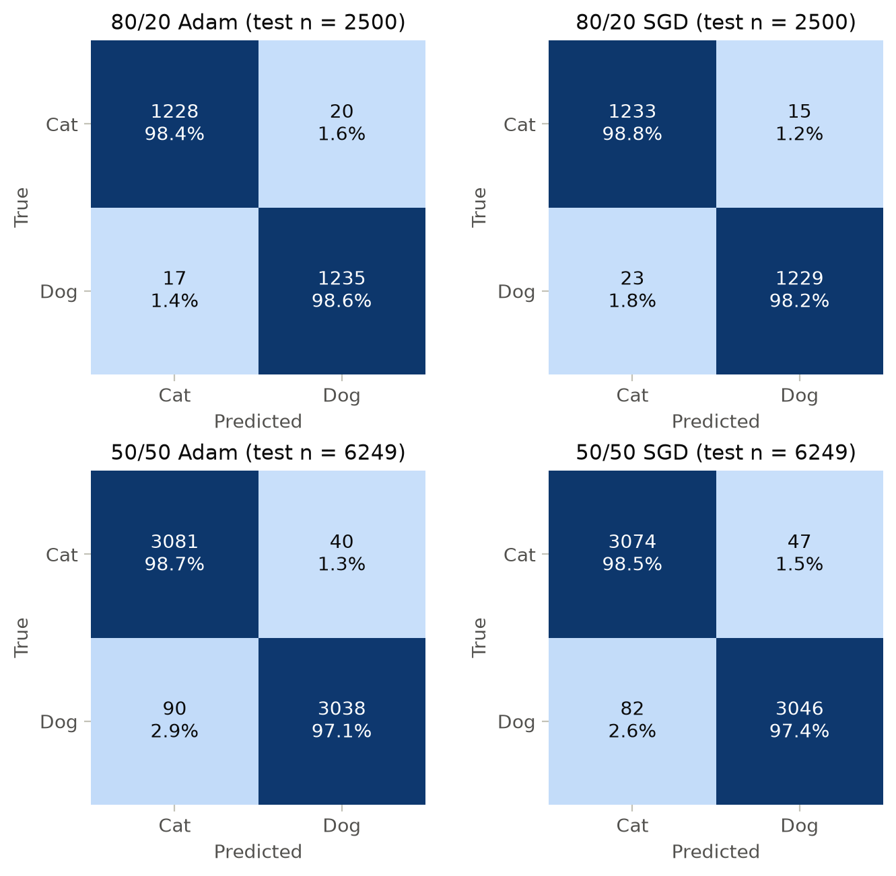
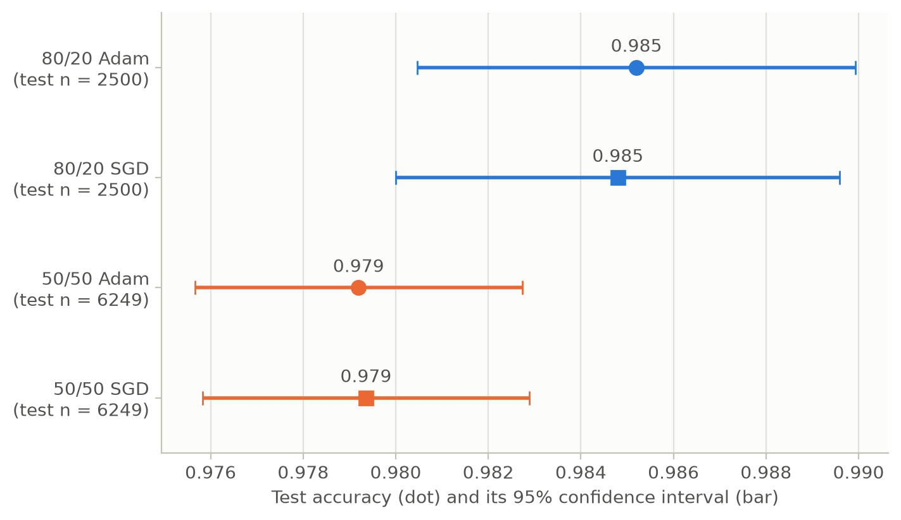
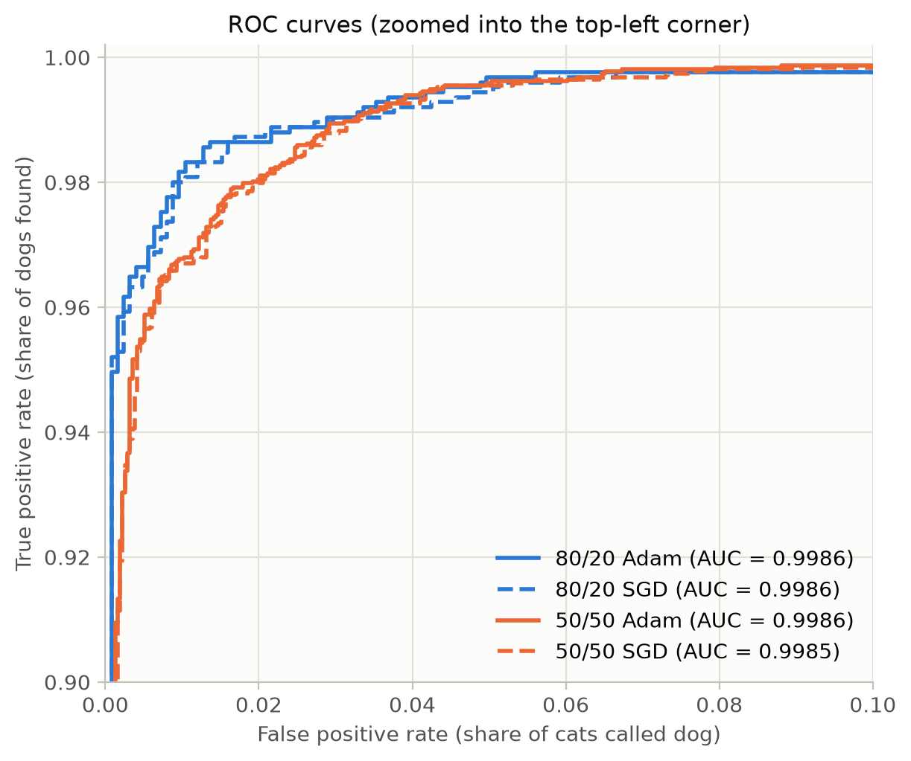

# Part 2 – Image Classification (Cat vs. Dog)

## Setup (model, data, preprocessing)

**Goal.** Train a classifier that decides whether an image shows a cat or a dog, and measure how well it works on images it has not seen during training. In the terms of Mitchell (1997) used in the lecture (Janiesch, 2025), the task T is to label an image as cat or dog, the experience E is the set of labeled training images, and the performance measure P is the accuracy, complemented by the metrics below. This makes it a supervised, dichotomous classification problem (Janiesch et al., 2021).

**Data.** We use the provided subset of the Microsoft Cats vs Dogs dataset from Kaggle: 12,499 image files (6,203 cats, 6,296 dogs). One cat file is empty and is removed by the notebook's image check, which leaves 12,498 valid images. About 1 % of the files are BMP, GIF or PNG images despite their .jpg extension; Pillow reads them without problems. Both classes are almost equally large (49.6 % cats, 50.4 % dogs), so a trivial model that always answers "Dog" would only reach about 50 % accuracy. This is the baseline every real model has to beat.

**Preprocessing.** Every image is resized to 256 px, center-cropped to 224 × 224 px and normalized with the ImageNet mean and standard deviation. These are exactly the transforms the pretrained weights expect (`ResNet18_Weights.IMAGENET1K_V1.transforms()`).

**Model (transfer learning).** We start from a ResNet-18 (He et al., 2016) that was pretrained on ImageNet and freeze all of its layers. Only the last fully connected layer is replaced by a new layer with two outputs (Cat, Dog), and only this layer is trained. It has 512 × 2 + 2 = 1,026 parameters, so the network reuses the visual features it learned on ImageNet and only learns how to combine them for our two classes.

**Training.** Cross-entropy loss, learning rate 0.001, batch size 32, 3 epochs per run. Every run uses the same random seed (42), so it gets the same data split and the same starting weights, and only the factor we vary changes. The model is evaluated on the test split after every epoch. One run took about 5.5 minutes on an NVIDIA RTX 2060 GPU.

We ran 2 split sizes × 2 optimizers = 4 experiments. A first single-epoch run (80/20, Adam) already reached a test accuracy of 0.984.

## Experiment 1 – Train/test split sizes

We compared two ways of splitting the 12,498 images:

| Split | Training images | Test images |
|---|---|---|
| 80/20 | 9,998 | 2,500 |
| 50/50 | 6,249 | 6,249 |

With 80/20 the models reach a test accuracy of about 98.5 %, with 50/50 about 97.9 %, for both optimizers (Table 1). With fewer training images, the new last layer sees fewer examples of each class and learns a slightly less accurate decision boundary. The confusion matrices (Figure 2) show where the difference comes from: cats are recognized equally well with both splits (98.4–98.8 %), but with 50/50 the models call 2.6–2.9 % of the dogs "cat", compared with 1.4–1.8 % with 80/20. A plausible explanation is that dogs vary much more in appearance (breeds, sizes, coats) than cats, so they need more training examples.

The split size also changes how reliable the measurement is. The 50/50 test set is 2.5 times larger, so its accuracy has a smaller margin of error: ± 0.35 percentage points instead of about ± 0.47 (95 % confidence interval, Figure 3). Choosing a split is therefore a trade-off: more training data gives a better model, more test data gives a more trustworthy estimate of how good the model is.

The training time was almost the same for both splits (5.3–5.6 minutes). Because the backbone is frozen, most of the time goes into passing images through ResNet-18, and every epoch processes all 12,498 images once (training plus test), however they are split.

## Experiment 2 – Optimizers

We compared Adam (Kingma & Ba, 2015) with stochastic gradient descent (SGD) with momentum 0.9, both with a learning rate of 0.001. Plain SGD would converge very slowly at this learning rate, so we added momentum.

Within each split, both optimizers end at practically the same result: 0.9852 vs. 0.9848 test accuracy with 80/20, and 0.9792 vs. 0.9794 with 50/50. They differ a little in the first epoch (Figure 1): with 80/20 Adam starts slightly better (training accuracy 0.943 vs. 0.939), with 50/50 SGD does (0.916 vs. 0.906). After three epochs the curves have met. The kind of mistakes differs slightly as well: with 80/20, Adam misses fewer dogs (17 vs. 23) but calls more cats "dog" (20 vs. 15). These are a few images out of 2,500 and well within the margin of error.

The reason is that we only train one linear layer with 1,026 parameters on top of fixed, already very good features. This is essentially a logistic regression: a convex problem without local minima, so both optimizers head for the same solution. Adam's strength, adapting the step size for every parameter, matters most in deep networks with millions of parameters and has little to add here.

## Metrics

The lecture recommends reporting multiple metrics to avoid measurement bias (Janiesch, 2025), so we report seven. Dog is treated as the positive class. TP are dogs predicted as dog, TN cats predicted as cat, FP cats predicted as dog, and FN dogs predicted as cat.

| Metric | Formula | Question it answers |
|---|---|---|
| Accuracy | (TP + TN) / all | What share of all images is classified correctly? |
| Precision | TP / (TP + FP) | When the model says "dog", how often is it right? |
| Recall | TP / (TP + FN) | What share of the dogs does the model find? |
| Specificity | TN / (TN + FP) | What share of the cats does the model find? |
| F1 score | 2 · Precision · Recall / (Precision + Recall) | One number that balances precision and recall |
| ROC-AUC | area under the ROC curve | How well do the predicted dog probabilities rank dogs above cats, over all thresholds? (1 = perfect, 0.5 = guessing) |
| Test loss | average cross-entropy | How confident and correct are the predicted probabilities? |

For the accuracy we also report a 95 % confidence interval, ± 1.96 · √(p · (1 − p) / n), where p is the accuracy and n the number of test images.

Because both classes are almost equally frequent (for example 1,248 cats and 1,252 dogs in the 80/20 test set), accuracy is a fair summary here. It does not show which class the errors fall on, though; precision, recall and specificity do. ROC-AUC adds a view that does not depend on the 0.5 decision threshold.

## Visualizations (table and graphs)

**Table 1 – Test results after 3 epochs**

| Run | Train / test images | Test accuracy (± 95 % CI) | Precision | Recall | Specificity | F1 | ROC-AUC | Test loss |
|---|---|---|---|---|---|---|---|---|
| 80/20 Adam | 9,998 / 2,500 | 0.9852 ± 0.0047 | 0.9841 | 0.9864 | 0.9840 | 0.9852 | 0.9986 | 0.0458 |
| 80/20 SGD | 9,998 / 2,500 | 0.9848 ± 0.0048 | 0.9879 | 0.9816 | 0.9880 | 0.9848 | 0.9986 | 0.0492 |
| 50/50 Adam | 6,249 / 6,249 | 0.9792 ± 0.0035 | 0.9870 | 0.9712 | 0.9872 | 0.9791 | 0.9986 | 0.0560 |
| 50/50 SGD | 6,249 / 6,249 | 0.9794 ± 0.0035 | 0.9848 | 0.9738 | 0.9849 | 0.9793 | 0.9985 | 0.0564 |

**Figure 1 – Accuracy and loss after every epoch.** Color shows the split (blue 80/20, orange 50/50), line style the optimizer (solid Adam, dashed SGD). The test accuracy is already about 98 % after the first epoch. The 50/50 runs start lower on the training data but catch up by epoch 2. The small dip of the 80/20 runs in epoch 2 (0.976–0.979) is within the margin of error.

**Figure 2 – Confusion matrices.** Each cell shows the number of images and the share of its true class. The 50/50 runs lose accuracy mainly by calling dogs "cat" (bottom-left cells).

**Figure 3 – Test accuracy with 95 % confidence interval.** The 80/20 runs are about 0.6 percentage points better, but the intervals overlap slightly. The larger 50/50 test set gives narrower intervals.

**Figure 4 – ROC curves, zoomed into the top-left corner.** All four models reach an AUC of about 0.9986. At low false positive rates the 80/20 curves are higher: with a strict threshold they find more dogs while calling few cats "dog".

## Discussion – why the results differ

- **The split size matters more than the optimizer.** Going from 9,998 to 6,249 training images costs about 0.6 percentage points of accuracy, while switching between Adam and SGD changes almost nothing. With a frozen backbone, the only part that can improve is the last layer, and it benefits from more examples, especially of the more varied dog class.
- **The optimizer hardly matters** because training one linear layer on fixed features is a convex problem with one best solution, and both Adam and SGD with momentum reach it within three epochs.
- **All differences are small.** The best and the worst run are about 0.6 percentage points apart, and every model is far above the 50 % baseline. Each configuration was run only once, with one seed and one split, so differences below about half a percentage point, such as Adam vs. SGD, can be random. The lecture recommends cross-validation to check generalizability (Janiesch, 2025): training and testing on k different splits (for example 5-fold) and averaging the results would show how stable the numbers are.
- **Test accuracy is higher than training accuracy** in every run (for example 0.985 vs. 0.968 for 80/20 Adam). This is not an error. First, the training accuracy is averaged over an epoch while the weights are still changing, whereas the test accuracy is measured once at the end of the epoch. Second, in training mode the BatchNorm layers of the frozen backbone normalize every batch with its own statistics, which adds noise; evaluation uses stable running statistics.
- **No sign of overfitting.** The Case 1 slides read loss curves this way (Ciftci, 2026): a validation loss that falls and then rises again means overfitting. Here the test split plays the role of the validation set. The training loss falls steadily in every run, and the test loss after epoch 3 is lower than after epoch 1 (for example 0.060 → 0.046 for 80/20 Adam); the small rise of the 80/20 runs in epoch 2 does not continue. With only 1,026 trainable parameters, the model has little capacity to memorize individual training images.
- **ROC-AUC is almost identical (0.9985–0.9986)** for all runs, so all models separate cats from dogs equally well when we look at their probabilities. The small differences in accuracy, precision and recall come from where exactly the images fall relative to the 0.5 threshold.
- **The pretrained features do most of the work.** After a single epoch, every model is already at 97.6–98.4 % test accuracy. Further gains would most likely need fine-tuning some backbone layers or data augmentation, not more epochs for the last layer.
- **High accuracy does not explain the model.** The metrics show how often the model is right, but not why. The lecture's wolf-vs-husky example (Janiesch, 2025; Ribeiro et al., 2016) shows a classifier that was right for the wrong reason: it had learned to detect snow, not wolves. Our model could in principle also rely on the background, for example indoor or outdoor scenes, instead of the animal. Explainable AI methods such as LIME, the topic of Case 2, could show which image regions a prediction is based on.

## References

- Ciftci, S. A. (2026). *Case 1 – Machine Learning und Artificial Intelligence* [Exercise slides]. Advanced Enterprise Computing, Chair of Enterprise Computing, TU Dortmund University.
- He, K., Zhang, X., Ren, S., & Sun, J. (2016). Deep residual learning for image recognition. *Proceedings of the IEEE Conference on Computer Vision and Pattern Recognition (CVPR)*, 770–778.
- Janiesch, C. (2025). *AI technology foundations* [Lecture slides]. Advanced Enterprise Computing, Chair of Enterprise Computing, TU Dortmund University.
- Janiesch, C., Zschech, P., & Heinrich, K. (2021). Machine learning and deep learning. *Electronic Markets*, 31(3), 685–695.
- Kingma, D. P., & Ba, J. (2015). Adam: A method for stochastic optimization. *Proceedings of the 3rd International Conference on Learning Representations (ICLR)*.
- Mitchell, T. M. (1997). *Machine learning*. McGraw-Hill.
- Ribeiro, M. T., Singh, S., & Guestrin, C. (2016). "Why should I trust you?": Explaining the predictions of any classifier. *Proceedings of the 22nd ACM SIGKDD International Conference on Knowledge Discovery and Data Mining*, 1135–1144.
- Microsoft Cats vs Dogs dataset (Kaggle mirror): https://www.kaggle.com/datasets/shaunthesheep/microsoft-catsvsdogs-dataset
